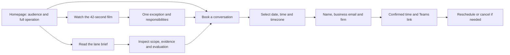

# Website revision — implementation and verification

Validated September 10–11, 2026. This is a website release candidate; production publication is a separate action.

## What changed

The homepage presents Catena as a managed operations platform running Records-to-Demand: records and billing operations from the first request through evidence-backed proof of demand readiness. The existing 42-second film occupies the hero in place of the abstract illustration. It remains clearly labeled as an operating-model illustration, not product output. The bill mismatch is a compact supporting example of one exception within the operation.

Repeated responsibility sections are combined. The lane brief now supplies scope, evidence questions, retained firm authority, and evaluation conditions, rather than retelling the homepage. Existing fonts, colors, wordmark, film assets, redirects, and relevant anchors remain.

Calls to action say **Book a 15-minute conversation**. Founder context appears under **Behind Catena**. Scheduling uses the official Cal.com React embed with a direct link and email fallback; the website does not promise a particular host. Cal.com still identifies the actual assigned host in its booking details.

## Visitor journey

Times below are design estimates, not measured user-study results.

| Visitor question | Location/action | Estimated time |
| --- | --- | --- |
| Is this for my firm, and what does Catena do? | First screen: plaintiff PI, managed platform, full operation | 5–15 seconds |
| How does the operation work? | Play the existing hero film | 42 seconds |
| What happens when a return is incomplete? | Compact example immediately after hero | 15–25 seconds |
| What work stays with us? | Responsibility comparison or direct navigation | 10–20 seconds |
| What would we evaluate? | One click to the lane brief and its section links | 1–3 minutes for detail |
| Can we commit to a conversation? | One click from header/hero to the calendar | About 1–2 minutes to select a slot and provide business contacts |

## Information, graphics, and copy

The hero aligns explanation and film at the top. Supporting headings are smaller and section spacing is tighter. The example uses a compact definition list, responsibilities use paired lists, and FAQs disclose secondary detail. Mobile navigation retains a visible booking link. The brief is printable with booking and email details included.

The wordmark, cream background, green palette, and serif headings retain the existing identity. The hero graphic now shows the actual explanatory film, replacing an interchangeable visual metaphor. No fabricated product screenshot, customer result, or implemented capability is introduced.

The copy states the complete operation first, then separates the firm's professional authority. The homepage no longer asks every section to repeat that distinction. The bill exception remains subordinate to the operation. The lane brief uses direct buyer questions about what prevents readiness, what Catena does next, and what decision the firm needs to make.

Calculated text contrast ratios: ink on paper **12.83:1**; green on paper **6.72:1**; secondary text on paper **5.80:1**; button text on green **7.32:1**; secondary text on sage **5.32:1**. These cover the authored text color combinations, not a claim of a complete accessibility audit of Cal.com.

## Verification

- Production build and TypeScript: passed.
- ESLint and whitespace check: passed.
- Existing contact endpoint regression suite: 97 tests passed. These tests use mocks and do not send mail.
- Browser smoke checks: 31 passed, including four routes at 1440, 1024, 390, and 320 CSS pixels, page metadata, preview noindex protections, keyboard skip link, mobile menu, FAQ disclosure, film playback/captions/transcript, print content, and redirects preserving query parameters.
- Additional booking UI checks: selected date/time visible before confirmation at 1440, 390, and 320 pixels; no iframe horizontal overflow; three business contact fields; navigating away and back produces one functional embed.
- Failure paths: blocking Cal.com produces the timeout notice with direct booking/email available. With JavaScript disabled, the empty calendar space is removed and the same alternatives remain.
- Production dependency audit: zero reported vulnerabilities at validation time. This is a point-in-time package audit, not a security certification.
- Controlled live scheduling test: an internally marked appointment was booked through the website using the owner's business email. Confirmation and reschedule emails arrived, a Teams link was generated, the occupied time and configured buffer were excluded, and rescheduling and cancellation succeeded.
- Cleanup: the test appointment was cancelled. Outlook showed zero events on the test day afterward. No prospect contact, client data, CRM record, or subscriber enrollment was used.

## Source and release boundary

This branch starts from **de1c98ad1d2b7a5497f0f4ecb4901ed114f596bb**, the source of the existing live release. Earlier direct deployments were committed locally but had not been pushed to GitHub; those commits are included so the repository preserves the deployed baseline.

The existing Vercel project is **prime-elixir/catena-landing**. Its production branch is **master**. Branch builds are protected previews. Preserve preview authentication and noindex behavior. Production must be rebuilt for the production environment; do not promote a noindex preview build.

The rollback baseline is deployment **dpl_478qE9jDojmjCfuF3YrFqs5ECMD9** at **catena-landing-8w2ajyq33-prime-elixir.vercel.app**. Website publication does not authorize operational platform admission, DNS changes, or changes to other projects.

After a publication decision, verify the live homepage, brief, conversation page, privacy notice, redirects, indexability, and scheduler load. The authenticated owner remains the current booking host until the salesperson's account and availability are assigned in Cal.com.
